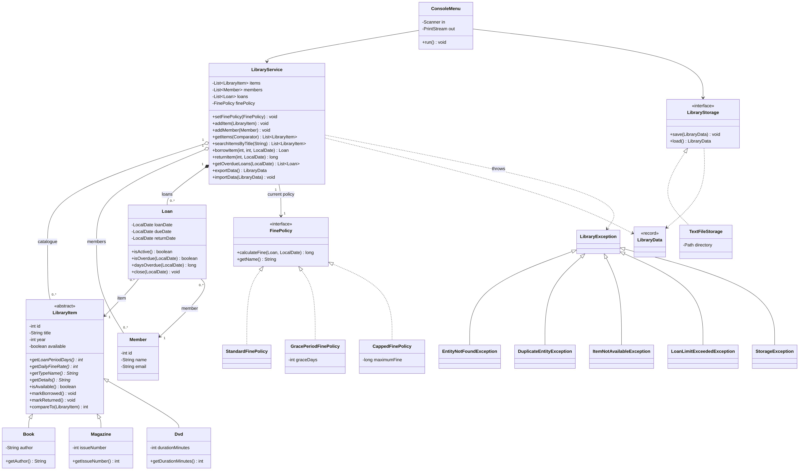

# Design notes

## Problem statement

**Users.** The librarian of a small library, for example a school or dormitory library,
who currently tracks loans on paper or in a spreadsheet.

**Goal.** Know at any moment what the library owns, who has which item, when it is due back,
and how much a late member has to pay.

**Problem solved.** On paper it is easy to lend the same item twice, to lose track of due dates,
and to calculate late fees inconsistently. The application enforces the lending rules,
calculates due dates and fees automatically, and keeps the data between runs.

## UML class diagram

The editable source is [class-diagram.mmd](class-diagram.mmd) (Mermaid; GitHub and
<https://mermaid.live> can display and edit it).

## Design pattern: Strategy

The late fee calculation is the part of the library most likely to change, so it is separated
from the rest of the logic.

- `FinePolicy` (interface) is the strategy: `calculateFine(Loan, LocalDate)`.
- `StandardFinePolicy`, `GracePeriodFinePolicy` and `CappedFinePolicy` are the concrete strategies.
- `LibraryService` is the context. It stores one `FinePolicy` in a field, uses it in
  `returnItem` and `calculateFine`, and lets it be replaced with `setFinePolicy`.
- `ConsoleMenu` is the client: menu option 10 creates a policy and passes it to the service.

In the diagram this is the `LibraryService --> FinePolicy` association together with the three
classes that realize `FinePolicy`. `LibraryService` never mentions a concrete policy class,
so adding a fourth policy requires no change to it.

## Main design decisions

1. **Abstract class for items, interface for policies and storage.** Items share state
   (id, title, year, availability), so an abstract class avoids repeating it. Policies and
   storage share only behavior, so they are interfaces.
2. **The item type decides its own loan period and daily rate.** `Loan` asks the item for
   `getLoanPeriodDays()` instead of checking the type with `if` or `instanceof`.
3. **Dates are passed in as parameters.** `LibraryService` never calls `LocalDate.now()`;
   the console passes the date. This makes the rules testable with fixed dates.
4. **Checked domain exceptions.** Breaking a library rule is an expected situation the user
   interface must handle, so `LibraryException` is checked. Programming mistakes such as an
   empty title use the standard unchecked `IllegalArgumentException`.
5. **Storage behind an interface.** `LibraryService` knows nothing about files; it only
   exports and imports a `LibraryData` snapshot. Another format (JSON, a database) would be
   a new `LibraryStorage` implementation.
6. **Plain text files with no external libraries.** The data is small and simple, and the files
   can be opened and checked by hand.
7. **Automatic save after every change**, so a crash or a closed window does not lose data.
8. **Layered packages.** `ui` depends on `service`, `service` depends on `domain` and `policy`;
   the domain classes depend on nothing else in the project.

## Known limitations

- Items and members cannot be edited or deleted once added.
- Each catalogue entry is a single copy; several copies of the same book must be added separately.
- The chosen fine policy is not saved; the program always starts with the standard policy.
- Fines are calculated and shown but payments are not recorded.
- The `|` character cannot be used in titles or names because it separates fields in the data files.
- Single user only; two running copies of the program would overwrite each other's files.
- No graphical user interface.
